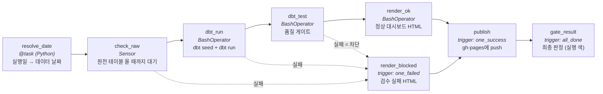
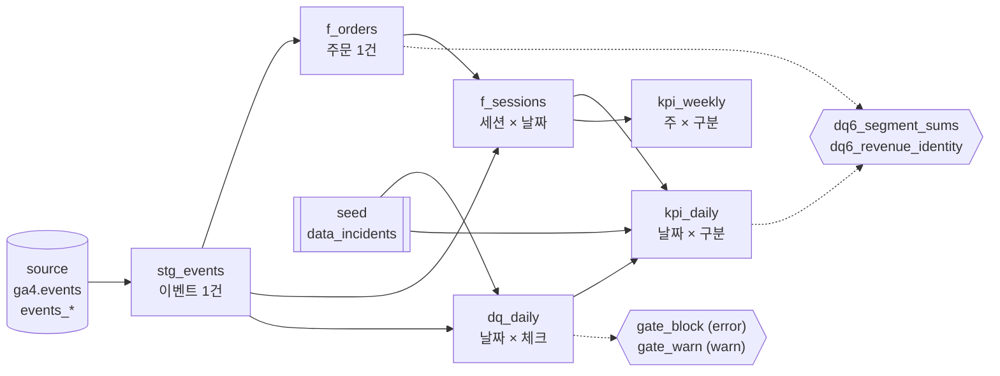

# 코드 해설 — 공부용

이 문서는 코드를 옆에 띄워 놓고 한 줄씩 따라 읽기 위한 안내서입니다. 링크(`파일#L줄번호`)를 누르면 그 줄로 갑니다.
도식은 Mermaid로 그렸습니다. GitHub에서는 바로 그림으로 보이고, VS Code에서는 확장 "Markdown Preview Mermaid Support"를 설치하면 미리보기(⌘⇧V)에서 보입니다.

**추천 읽는 순서**: 0 전체 그림 → 1 Airflow DAG → 2 dbt (staging → 사실 → 품질 → KPI → 테스트) → 3 대시보드 → 4 Docker → 5 실습

---

## 0. 전체 그림

### 0-1. Airflow DAG: 하루 한 번 도는 작업 순서



같은 내용을 글로 쓰면 (DAG 파일 마지막 세 줄, [L156–158](../airflow/dags/ga4_ops_daily.py#L156)):

```python
resolved >> check_raw >> dbt_run >> dbt_test >> render_ok          # 정상 경로
[check_raw, dbt_run, dbt_test] >> render_blocked                   # 셋 중 하나라도 실패하면
[render_ok, render_blocked] >> publish >> gate_result()            # 둘 중 하나가 성공하면 게시
```

**정상인 날과 차단된 날, 작업 상태가 어떻게 달라지나**

| 작업 | 정상인 날 | 차단된 날 (예: 1/26) | 원천이 안 온 날 |
|---|---|---|---|
| resolve_date | ✅ success | ✅ success | ✅ success |
| check_raw | ✅ success | ✅ success | ❌ failed (6시간 기다린 뒤) |
| dbt_run | ✅ success | ✅ success | ⏭ upstream_failed |
| dbt_test | ✅ success | ❌ **failed** (gate_block) | ⏭ upstream_failed |
| render_ok | ✅ success | ⏭ upstream_failed | ⏭ upstream_failed |
| render_blocked | ⏭ skipped | ✅ success | ✅ success |
| publish | ✅ success | ✅ success | ✅ success |
| gate_result | ✅ success | ❌ failed → **실행 빨간색** | ❌ failed |

> 핵심 아이디어: "게시"는 성공시키되(검수 실패 페이지를 올려야 하니까), "실행"은 실패로 남겨서 담당자가 Airflow 화면에서 바로 알아보게 한다.

### 0-2. dbt 모델 연결도 (lineage)



- 실선 = `ref()`로 읽는 관계. dbt가 이 그림을 보고 실행 순서를 스스로 정한다.
- 점선 = 테스트. 테스트도 `ref()`로 모델을 읽는 SQL이다.
- 직접 그래프로 보려면: `dbt docs generate && dbt docs serve` → 오른쪽 아래 lineage 버튼.

### 0-3. 하루 실행에서 데이터가 흐르는 길

```text
BigQuery 공개 데이터 events_20201217         (raw, 읽기 전용)
   └─ stg_events   파티션 2020-12-17 교체     (ga4_staging)
       ├─ f_orders   파티션 2020-12-17 교체   (ga4_mart)
       ├─ f_sessions 파티션 2020-12-17 교체
       ├─ dq_daily   파티션 2020-12-17 교체
       └─ kpi_daily  파티션 2020-12-17 교체, kpi_weekly  그 주 파티션 교체
             └─ render.py 가 조회 → site/days/2020-12-17.html → .pages/ 복사 → gh-pages push
```

---

## 1. Airflow DAG — [airflow/dags/ga4_ops_daily.py](../airflow/dags/ga4_ops_daily.py)

### 1-1. 상수와 날짜 대응 ([L26–34](../airflow/dags/ga4_ops_daily.py#L26))

```python
OP_START, OP_END = date(2020, 11, 30), date(2021, 1, 24)   # 운영 기간
LIVE_DATA_START = date(2021, 1, 11)                         # 라이브 첫 데이터 날짜
BACKFILL_DAYS, LIVE_DAYS = 42, 14                           # 계산식으로 구함
GO_LIVE = os.environ.get("GA4_GO_LIVE_DATE") or None       # airflow/.env 에서 옴
```

- `DBT`, `PY`: 컨테이너 안에서 dbt와 렌더러를 부르는 명령 앞부분. 둘 다 `/opt/dbt-venv`(Airflow와 분리된 가상환경)의 실행 파일을 쓴다.
- `X = "ti.xcom_pull(task_ids='resolve_date')"`: 뒤에서 `{{ ... }}` 템플릿 안에 계속 넣을 문자열이라 이름을 붙여 둔 것. "resolve_date가 반환한 딕셔너리를 꺼내라"는 뜻.

### 1-2. 스케줄을 환경 변수로 결정 ([L45–50](../airflow/dags/ga4_ops_daily.py#L45))

```python
if GO_LIVE:
    go_live = pendulum.datetime(2026, 11, 27, tz=KST)            # 예시
    schedule = "0 7 * * *"                                        # 매일 07:00 (KST)
    start = go_live.subtract(days=42)                             # 42일 전 → catchup 이 백필이 됨
    end = go_live.add(days=13, hours=12)                          # 14번째 날까지
else:
    schedule = None                                               # 수동 실행만
```

- **이 파일의 가장 중요한 아이디어**: 시작일을 42일 앞으로 당겨 두면, DAG를 켜는 순간 Airflow가 "밀린 42번"을 자동으로 만든다(catchup). 이게 백필이다. 그 뒤로는 매일 한 번씩 돈다(라이브).
- `.env`만 바꾸고 `docker compose up -d`를 하면 스케줄이 바뀐다. 코드를 고칠 필요가 없다.

### 1-3. `@dag` 설정 ([L52–68](../airflow/dags/ga4_ops_daily.py#L52))

| 설정 | 값 | 이유 |
|---|---|---|
| `catchup=True` | 밀린 스케줄을 자동 실행 | Airflow 3은 기본값이 False라 꼭 명시 |
| `max_active_runs=1` | 한 번에 한 날짜만 | f_orders의 중복 제거와 7일 비교가 **이전 날짜 결과를 읽기** 때문에 순서가 중요 |
| `depends_on_past=False` | 어제 실패해도 오늘은 돈다 | 하루가 막혀도 다음 날 대시보드는 나와야 함 |
| `retries=1` | 일시적 오류 1회 재시도 | 단, `dbt_test`·`check_raw`·`publish`는 `retries=0` (데이터 문제는 재시도로 안 고쳐짐) |
| `on_failure_callback=alert` | 실패 시 알림 | 지금은 로그. Slack을 보내려면 `alert()` 안만 바꾸면 됨 |
| `params` | `data_date`, `target` | 수동 실행 때 `{"data_date": "2020-12-17", "target": "test"}` 처럼 넘김 |

### 1-4. `resolve_date` — Python 작업 ([L70–90](../airflow/dags/ga4_ops_daily.py#L70))

```python
run_day = context["logical_date"].in_timezone(KST).date()
d = LIVE_DATA_START + (run_day - date.fromisoformat(GO_LIVE))
```

- `logical_date`는 UTC다. 07:00 KST 실행의 logical_date는 **UTC 전날 22:00**. 그래서 KST로 바꾼 뒤 날짜를 뽑는다. 이걸 안 하면 하루씩 밀린다.
- `target == "prod"`인데 운영 기간 밖 날짜면 일부러 실패시킨다(`AirflowFailException`). 실수로 결함 구간을 운영 마트에 넣지 않게 하는 안전장치.
- 반환한 딕셔너리(`data_date`, `suffix`, `dataset`, `site` …)는 **XCom**에 저장되고, 뒤 작업들이 `{{ ti.xcom_pull(...)['data_date'] }}`로 꺼내 쓴다.

### 1-5. `check_raw` — Sensor ([L94–104](../airflow/dags/ga4_ops_daily.py#L94))

```python
BigQueryTableExistenceSensor(
    project_id="bigquery-public-data", dataset_id="ga4_obfuscated_sample_ecommerce",
    table_id="events_{{ ti.xcom_pull(...)['suffix'] }}",     # 예: events_20201217
    mode="reschedule", poke_interval=600, timeout=6*3600)
```

- **Sensor** = "조건이 참이 될 때까지 기다리는 작업". 여기서는 "그날 원천 테이블이 생겼나".
- `mode="reschedule"`: 확인과 확인 사이에 작업 슬롯을 반납하고 쉰다. Airflow 화면에서 `up_for_reschedule`(다시 확인 예정) 상태로 보인다. `poke` 모드는 기다리는 내내 슬롯을 붙잡는다.
- 연결 정보는 `google_cloud_default` → docker-compose의 `AIRFLOW_CONN_GOOGLE_CLOUD_DEFAULT` 환경 변수에서 온다.

### 1-6. `dbt_run`, `dbt_test` ([L106–108](../airflow/dags/ga4_ops_daily.py#L106))

```bash
cd /opt/project/dbt && dbt seed ... && dbt run --profiles-dir . --vars '{run_date: "2020-12-17"}' --target prod
cd /opt/project/dbt && dbt test --profiles-dir . --vars '{run_date: "2020-12-17"}' --target prod
```

- `--vars`의 `run_date`가 dbt 모델 안의 `var('run_date')`로 들어간다 (§2 참고).
- `--target test`면 마트가 `ga4_mart_test`에 써진다 (profiles.yml).
- **왜 `dbt build`가 아니라 둘로 나눴나**: `build`는 테스트 실패 시 하위 모델을 건너뛴다 → 차단일의 `kpi_daily`가 비어 버림. 나누면 모델은 항상 만들어지고, 게이트는 `dbt test`의 종료 코드(실패 = 1)로 판정된다. BashOperator는 종료 코드가 0이 아니면 작업을 실패로 표시한다.

### 1-7. `render_ok`, `render_blocked` ([L110–118](../airflow/dags/ga4_ops_daily.py#L110))

- 둘 다 같은 `dashboard/render.py`를 부른다. `render_blocked`만 `--blocked-reason`을 붙여 "검수 실패" 페이지를 강제한다.
- `trigger_rule="one_failed"`: 위쪽(upstream) 작업 중 **하나라도 실패하면** 실행된다. 모두 성공하면 `skipped`.
- 테스트(`target=test`) 실행은 `site`가 `airflow/logs/site_test`라 실제 사이트에 섞이지 않는다.

### 1-8. `publish` — 셸 스크립트 ([L120–143](../airflow/dags/ga4_ops_daily.py#L120))

```bash
[ target != prod ] && exit 0                      # 테스트는 게시 안 함
cd /opt/project/.pages                            # gh-pages 브랜치 클론
rsync -a --delete --exclude .git ... site/ ./     # site 내용을 그대로 복사
git add -A
git diff --cached --quiet || git commit -m "publish: data 2020-12-17 ..."   # 바뀐 게 있을 때만 커밋
git -c http.extraHeader="Authorization: Basic ..." push origin gh-pages      # 항상 push
echo "published"                                  # 이 마지막 줄이 XCom 이 됨
```

- `trigger_rule="one_success"`: 정상 화면이든 검수 실패 화면이든 **하나라도 만들어졌으면** 게시.
- 토큰을 URL(`https://토큰@github.com`)에 넣지 않고 **HTTP 헤더**로만 보낸다 → git이 에러를 낼 때 URL을 출력해도 토큰이 로그에 안 남는다.
- **항상 push** 하는 이유: 예전에 커밋만 되고 push가 실패한 적이 있었다. "커밋할 게 없으면 끝"으로 짜면 그 커밋이 영영 안 올라간다.

### 1-9. `gate_result` — 최종 판정 ([L146–154](../airflow/dags/ga4_ops_daily.py#L146))

```python
if ti.xcom_pull(task_ids="render_blocked"):   raise AirflowFailException(...)   # 차단된 날
if ti.xcom_pull(task_ids="publish") is None:  raise AirflowFailException(...)   # 게시 실패
```

- DAG 실행의 색(성공/실패)은 **마지막(리프) 작업**의 결과로 정해진다. 그래서 맨 끝에 판정 작업을 둔다.
- XCom 트릭: BashOperator는 마지막 출력 줄을 XCom에 저장한다. `render_blocked`가 실행됐으면 값이 있고(= 차단), `publish`가 끝까지 갔으면 `"published"`가 있다. 실패했거나 건너뛰었으면 `None`.
- `trigger_rule="all_done"`: 위가 성공이든 실패든 **끝나기만 하면** 실행.

---

## 2. dbt — [dbt/](../dbt)

### 2-0. 설정 파일

| 파일 | 하는 일 |
|---|---|
| [dbt_project.yml](../dbt/dbt_project.yml) | 프로젝트 이름, 폴더 위치, 기본 변수 `run_date`, staging 폴더는 `ga4_staging` 데이터셋으로 |
| [profiles.yml](../dbt/profiles.yml) | BigQuery 접속. `prod` → `ga4_mart`, `test` → `ga4_mart_test`. 키 파일 경로는 `env_var('GCP_KEYFILE')`로만 받아서 비밀 정보가 없다 |
| [macros/generate_schema_name.sql](../dbt/macros/generate_schema_name.sql) | dbt 기본 규칙은 데이터셋 이름을 `ga4_mart_ga4_staging`처럼 붙인다. 이 매크로가 그 규칙을 덮어써서 `ga4_staging` 그대로 쓰게 한다 |

**모든 모델에 공통으로 나오는 패턴 3가지**

```sql
{{ config(materialized='incremental', incremental_strategy='insert_overwrite',
          partition_by={'field': 'event_date', 'data_type': 'date'}) }}     -- ① 날짜 파티션 교체
                  -- ② 처리할 날짜 범위
... from {{ ref('stg_events') }} where event_date between ... and ...       -- ③ ref 로 읽기
```

1. **incremental + insert_overwrite**: 이번 실행 결과에 들어 있는 날짜 파티션만 통째로 갈아 끼운다. 같은 날을 다시 돌려도 같은 결과(멱등성). 처음 실행(테이블이 없을 때)은 그냥 새로 만든다.
2. **`var()`**: Airflow가 `--vars '{run_date: ...}'`로 넘긴 값. 평소엔 하루, 최초 전체 생성 때는 `start_date`~`end_date` 범위.
3. **`ref()` / `source()`**: 테이블 이름을 직접 쓰지 않고 모델 이름으로 부른다 → 실행 순서 자동 계산 + target(prod/test)에 맞는 데이터셋으로 자동 치환.
4. `{{ }}`, ``는 **Jinja**(템플릿 문법)다. dbt는 Jinja를 먼저 풀어서 순수 SQL로 만든 뒤 BigQuery에 보낸다. 풀린 SQL은 `dbt/target/compiled/` 아래에서 볼 수 있다.

### 2-1. [stg_events.sql](../dbt/models/staging/stg_events.sql) — 배열 펼치기

```sql
where _table_suffix between format_date('%Y%m%d', date '2020-12-17') and ...      -- L19
(select value.int_value from unnest(event_params) where key = 'ga_session_id')   -- L28
```

- `events_*`는 **와일드카드 테이블**. `_table_suffix`가 `*` 자리의 글자(`20201217`)다. 이걸로 필요한 날짜 테이블만 읽어서 비용을 줄인다.
- GA4의 `event_params`는 `[{key, value}, …]` 배열이다. **"배열을 잠깐 펼쳐서(`unnest`) key가 X인 값 하나만 꺼내는 서브쿼리"** 패턴이 GA4 SQL의 기본기다.
- 마지막의 `is_no_tid_purchase`, `is_empty_purchase` 플래그는 품질 체크(DQ2)의 재료다. 여기서 한 번 계산해 두면 아래 모델들은 플래그만 보면 된다.

### 2-2. [f_orders.sql](../dbt/models/mart/f_orders.sql) — 주문 1건 = 거래번호 1개

```sql
qualify row_number() over (partition by transaction_id order by event_ts, session_key) = 1   -- L29

where transaction_id not in (select transaction_id from {{ this }} where order_date < date '...')  -- L45-48

```

- `row_number() ... = 1` + `qualify`: 같은 거래번호 중 **가장 먼저 찍힌 이벤트 하나**만 남긴다. `qualify`는 윈도 함수 결과로 거르는 BigQuery 문법(서브쿼리 없이 `WHERE`처럼).
- `is_incremental()`: 테이블이 이미 있고 증분 실행 중일 때만 참. 그때 **이전 날짜에 이미 있는 거래번호는 뺀다**(anti-join). `{{ this }}`는 "지금 만들고 있는 이 테이블 자신".
- 그래서 날짜 순서대로 돌려야 한다 → DAG의 `max_active_runs=1`.

### 2-3. [f_sessions.sql](../dbt/models/mart/f_sessions.sql) — 세션 × 날짜, 퍼널 도달

```sql
logical_or(event_name = 'view_item') as has_view_item      -- L29: 이 세션에 view_item 이 하나라도 있었나
... left join orders o on o.order_date = s.session_date and o.session_key = s.session_key   -- L66
```

- `logical_or`는 "그룹 안에 참이 하나라도 있으면 참"인 집계 함수. 퍼널을 **도달 여부**로 세는 정의를 그대로 옮긴 것.
- `is_checkout_with_cart` / `is_checkout_direct`: 결제 막대를 "장바구니 경유 / 바로 결제"로 나눌 재료.
- 주문은 `f_orders`에서 붙인다 → 빈 구매만 있는 세션은 `has_valid_order = false`.

### 2-4. [dq_daily.sql](../dbt/models/mart/dq_daily.sql) — 품질 판정 (가장 긴 모델, 천천히)

| 구간 | 줄 | 하는 일 |
|---|---|---|
| 기준값 | [L20–25](../dbt/models/mart/dq_daily.sql#L20) | ``으로 기준값을 한곳에 모아 둠. 기준을 바꾸려면 여기만 고친다 |
| `days` | [L27](../dbt/models/mart/dq_daily.sql#L27) | 날짜 목록을 먼저 만든다(`generate_date_array`). 데이터가 **0건인 날도 행이 있어야** "미도착"을 판정할 수 있기 때문 |
| `sessions`, `orders`, `daily` | L38–84 | 날짜별 재료 집계 (세션 수, 단계별 세션, 거래번호 없는 구매 세션, 매출 합) |
| `excluded_days` | [L86](../dbt/models/mart/dq_daily.sql#L86) | 결함 구간 + **이전에 차단된 날** (`{{ this }}`에서 읽음) → 기준선에서 뺄 날 |
| `baseline` | [L102](../dbt/models/mart/dq_daily.sql#L102) | 직전 7일 중 유효한 날의 평균. `baseline_days`가 5 미만이면 판정 보류 |
| `diag` | [L113](../dbt/models/mart/dq_daily.sql#L113) | DQ2 진단 정보 문자열 (사용자·세션 수, 기기, 브라우저) |
| `checks` | [L131](../dbt/models/mart/dq_daily.sql#L131) | 체크마다 `select … union all`로 행을 만들고 `case when`으로 ok/warn/block 판정 |
| DQ3 반복 | [L152](../dbt/models/mart/dq_daily.sql#L152) | `` → Jinja가 같은 SQL을 4번 찍어 낸다 (조회·장바구니·결제·구매) |

- 이 모델은 `stg_events`만 읽는다. 마트(`f_orders` 등)와 독립적으로 판정해야, 마트 계산이 틀렸을 때도 품질 판정은 믿을 수 있다.

### 2-5. [kpi_daily.sql](../dbt/models/mart/kpi_daily.sql) — 대시보드 숫자와 비교값

```sql
cross join unnest([                                       -- L22: 세션 1행을 3행으로 복제
    struct('all' as segment_type, 'all' as segment_value),
    struct('device', s.device_group),
    struct('visitor', if(s.is_new_session, 'new', 'returning'))
]) as seg
```

- **한 번의 GROUP BY로 전체·기기별·신규/재방문별을 동시에** 만드는 트릭. 세션 하나가 "전체" 행, "데스크톱" 행, "신규" 행으로 세 번 들어간다.
- `invalid_days` ([L50](../dbt/models/mart/kpi_daily.sql#L50)): 결함 구간 + `dq_daily`에서 차단된 날. 비교 기준에서 뺀다.
- `wow` ([L73](../dbt/models/mart/kpi_daily.sql#L73)): 7일 전 날짜와 **inner join** → 그날이 유효하지 않으면 join이 안 돼서 자연스럽게 null = "비교 불가".
- `avg7` ([L82](../dbt/models/mart/kpi_daily.sql#L82)): 직전 7일 중 유효한 날을 모아 합계를 낸다. 최종 select에서 `if(avg7_valid_days >= 5, …, null)` ([L135](../dbt/models/mart/kpi_daily.sql#L135)).
- 비율 지표의 7일 평균은 **일별 비율의 평균이 아니라 합계의 비율**(`orders_7d / sessions_7d`). 구매가 적은 날의 비율이 과하게 반영되지 않게.
- 비교를 위해 앞 7일을 함께 읽지만(`date_sub(start, 7)`), 결과는 처리 날짜만 쓴다(`target_days`).

### 2-6. [kpi_weekly.sql](../dbt/models/mart/kpi_weekly.sql) — 주간

- `per_session` ([L32](../dbt/models/mart/kpi_weekly.sql#L32)): 세션 키로 한 번 더 묶어서, 자정을 넘긴 세션을 주간에서 두 번 세지 않는다.
- 하루를 처리할 때 그 날이 속한 **주 전체**를 다시 계산해서 그 주 파티션을 교체한다.

### 2-7. 테스트 — [dbt/tests/](../dbt/tests)

| 파일 | 심각도 | 실패 조건 (결과 행이 1개라도 나오면 실패) |
|---|---|---|
| [gate_block.sql](../dbt/tests/gate_block.sql) | **error** | 그날 `dq_daily.status = 'block'` |
| [gate_warn.sql](../dbt/tests/gate_warn.sql) | warn | 그날 `status = 'warn'` (실패해도 dbt는 통과) |
| [dq6_segment_sums.sql](../dbt/tests/dq6_segment_sums.sql) | error | 기기별 합 ≠ 전체, 신규+재방문 ≠ 전체 |
| [dq6_revenue_identity.sql](../dbt/tests/dq6_revenue_identity.sql) | error | 매출 ≠ 세션×전환율×객단가, 또는 KPI ≠ f_orders 합계 |
| `_mart.yml`, `_staging.yml` 안 | error | `unique`, `not_null`, `accepted_values` (dbt 기본 제공 테스트) |

- dbt 테스트의 규칙은 단 하나: **"문제인 행을 고르는 SELECT를 쓴다. 0행이면 통과."**
- `severity='error'`가 하나라도 실패하면 `dbt test` 종료 코드가 1 → Airflow `dbt_test` 실패 → 게이트.

### 2-8. [seeds/data_incidents.csv](../dbt/seeds/data_incidents.csv)

- CSV 파일을 `dbt seed`로 테이블로 올린 것. 새 사고가 생기면 **한 줄 추가**만 하면 `dq_daily` 기준선과 `kpi_daily` 비교에서 자동으로 빠진다. 규칙을 코드에 박아 넣지 않고 데이터로 관리하는 방식.

---

## 3. 대시보드 — [dashboard/render.py](../dashboard/render.py)

| 함수 | 줄 | 하는 일 |
|---|---|---|
| `rows()` | [L31](../dashboard/render.py#L31) | BigQuery 쿼리 실행. 날짜는 **쿼리 파라미터**(`@d`)로 넘김 (문자열을 SQL에 이어 붙이지 않음) |
| `load()` | [L37](../dashboard/render.py#L37) | 마트 4개 조회: 그날 KPI, 최근 28일 추세, 끝난 주, 품질 판정. 주간은 `week_end < @d`로 **페이지 날짜 이후 데이터 차단** |
| `build_view()` | [L99](../dashboard/render.py#L99) | 화면에 넣을 값 계산. 품질 판정 → 전체 상태(ok/warn/block) 결정. block이면 KPI는 만들지 않고 끝 |
| 매출 분해 | [L143–157](../dashboard/render.py#L143) | `ln(매출 변화) = ln(세션) + ln(전환율) + ln(객단가)` → 곱셈 구조를 덧셈으로 바꿔 "어느 항이 얼마나"를 정확히 나눔 |
| `tile()`, `spark()` | [L189](../dashboard/render.py#L189), [L207](../dashboard/render.py#L207) | KPI 카드 값(▲▼, 기준값)과 14일 미니 추세선 좌표 |
| `trend_svg()` | [L230](../dashboard/render.py#L230) | 일별 매출 선 차트를 SVG 좌표로 직접 계산 (차트 라이브러리 없음) |
| `main()` | [L277](../dashboard/render.py#L277) | 인자 파싱 → 조회 → `site/days/<날짜>.html` 쓰기 → 목록 `index.html` 다시 만들기 |

템플릿 [dashboard.html.j2](../dashboard/templates/dashboard.html.j2):
- Jinja로 숫자를 HTML에 박아 넣는다 → 브라우저는 BigQuery에 접속하지 않는다(정적 페이지).
- 탭은 섹션 3개(`<section class="tabpage">`)를 두고, 맨 아래 작은 JS가 `data-tab` 클릭에 따라 하나만 보여 준다. 주소 `#quality`로 바로 품질 탭을 열 수 있다.

---

## 4. Docker — [airflow/](../airflow)

- [Dockerfile](../airflow/Dockerfile): 공식 `apache/airflow:3.3.2` 이미지 + `/opt/dbt-venv`에 dbt·렌더러 의존성 설치.
- [docker-compose.yaml](../airflow/docker-compose.yaml):
  - `x-airflow: &airflow` ([L7](../airflow/docker-compose.yaml#L7)): YAML **앵커**. 공통 설정을 한 번 쓰고 `<<: *airflow`로 서비스 4개가 재사용.
  - 서비스: `postgres`(메타데이터 DB) → `airflow-init`(DB 준비, 1회) → `airflow-apiserver`(UI, 8080), `airflow-scheduler`, `airflow-dag-processor`.
  - 볼륨 ([L25–32](../airflow/docker-compose.yaml#L25)): 내 폴더(`../dbt`, `../dashboard`, `../site`, `../.pages`)를 컨테이너 `/opt/project/...`에 연결. 그래서 dbt 파일을 고치면 컨테이너를 다시 만들 필요 없이 바로 반영된다.
  - 키 파일은 `:ro`(읽기 전용)로만 연결.
  - `LocalExecutor`: 작업을 스케줄러 안의 프로세스로 실행. 로컬 한 대에서는 이걸로 충분 (분산은 Celery/Kubernetes).

---

## 5. 직접 해 볼 실습

난이도 순입니다. 모두 **테스트 데이터셋이나 읽기 전용**이라 운영에 영향이 없습니다. (dbt 명령은 `dbt/` 폴더에서, `GCP_KEYFILE`을 설정한 뒤 실행)

1. **Jinja가 만든 실제 SQL 보기**
   ```bash
   ../.venv/bin/dbt compile --profiles-dir . -s f_orders --vars '{run_date: "2020-12-17"}'
   ```
   → `target/compiled/ga4_ops/models/mart/f_orders.sql`를 열어 `{{ }}`가 어떻게 바뀌었는지 비교. `is_incremental()` 부분이 들어가 있나?

2. **dq_daily의 ``가 펼쳐진 모습 보기**: 같은 방법으로 `dq_daily`를 compile해서 DQ3 블록이 4번 반복된 것 확인.

3. **lineage 그래프 보기**
   ```bash
   ../.venv/bin/dbt docs generate --profiles-dir . && ../.venv/bin/dbt docs serve --profiles-dir .
   ```

4. **멱등성 직접 확인**: BigQuery 콘솔에서 `SELECT COUNT(*) FROM ga4_mart_test.f_orders` → 아래 실행을 두 번 → 다시 COUNT. 같은가?
   ```bash
   ../.venv/bin/dbt run --profiles-dir . --target test -s f_orders --vars '{run_date: "2020-12-18"}'
   ```

5. **게이트를 일부러 터뜨려 보기**: [dq_daily.sql L21](../dbt/models/mart/dq_daily.sql#L21)의 `dq2_block`을 `0.01`로 바꾸고 테스트 target으로 12/18을 run → test. `gate_block`이 실패하나? (**확인 후 반드시 원래 값 0.4로 되돌리기**)

6. **Airflow에서 테스트 실행 따라가기**: UI → `ga4_ops_daily` → ▶ Trigger → conf에 `{"data_date": "2021-01-26", "target": "test"}`. 그래프에서 어느 작업이 빨간색/분홍색(upstream_failed)/회색(skipped)이 되는지, `dbt_test` 로그에서 어떤 테스트가 실패했는지 확인. 0-1의 표와 비교.

7. **질문에 스스로 답해 보기** (답은 이 문서 안에 있음)
   - `max_active_runs`를 3으로 바꾸면 어떤 결과가 틀어질 수 있나?
   - `render_blocked`의 trigger_rule을 기본값(all_success)으로 두면 어떻게 되나?
   - `kpi_daily`의 `wow`를 `left join`으로 바꾸면 "비교 불가"는 어떻게 표시될까?
   - `publish`에서 `exit 0`(커밋할 게 없으면 끝)으로 바꾸면 어떤 장애가 다시 생기나?
